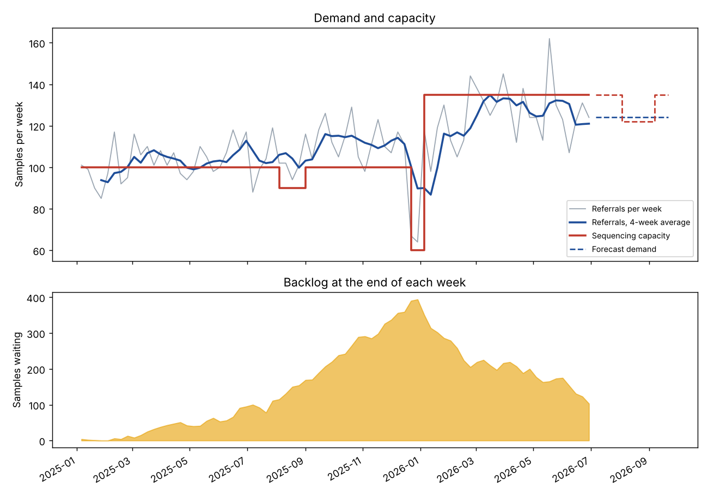

# Genomic testing service: demand, capacity and backlog

An analysis of whether a genomic testing laboratory can keep up with the referrals it receives, how long patients wait for a result, and what extra capacity would clear the queue. It is built as a small, tested data pipeline: SQL Server scripts and a Python (pandas) pipeline that give the same answers.

> **The data is synthetic.** No real patient or NHS data is used. A short simulation of a laboratory queue (`dcap/simulate.py`) makes the referral file. The turnaround targets are **assumptions for this exercise, not NHS standards**. The results show how the method works. They are not findings about any real service.



## The business questions

1. Is demand (referrals) growing faster than capacity (samples sequenced per week)?
2. How large did the backlog get, and when?
3. Did patients wait longer than the target? Did urgent and routine cases suffer the same?
4. What will demand be over the next 12 weeks, and is there a gap against planned capacity?
5. How much extra weekly capacity clears today's backlog in good time?

## What the analysis found (on this synthetic data)

- **Demand grew about 0.45 referrals per week, from about 97 a week (first 8 weeks) to about 127 (last 8 weeks).** A fixed capacity of 100 samples a week fell behind from early 2025.
- **The backlog peaked at 394 samples at the end of December 2025.** The Christmas weeks cut capacity to 60 a week while referrals kept coming.
- **Urgent cases stayed within their target all through the period. Routine cases did not.** Only 35% of routine referrals made in December 2025 were reported within the assumed 42 days (the target was met for 100% before September 2025). Prioritising urgent work pushes the delay onto routine work.
- **A second sequencer in January 2026 (capacity 100 to 135 a week) turned the backlog around.** It was still 103 samples at the end of the data, because demand had grown to about 124 a week and ate most of the new capacity.
- **12-week outlook:** forecast demand is about 124 a week. Planned capacity is 135, except 122 in the August weeks. At the planned capacity the backlog does **not** clear within the 12 weeks. An extra 10 samples a week clears it in 7 weeks. An extra 20 clears it in 4.

## How it works

```
make_data.py          simulate referrals + planned capacity  ->  data/*.csv
run_pipeline.py       load -> clean -> measure -> forecast   ->  output/*.csv, output/*.png
sql/01..04            the same cleaning and measures in T-SQL
tests/                pytest tests + a check that the SQL matches the pandas results
```

| Step | Module | What it does |
|---|---|---|
| Clean | `dcap/clean.py` | Removes duplicates, standardises text, rejects rows with unknown values or dates in the wrong order. Rejected rows are kept in `output/rejected_rows.csv` with a reason. Row counts are logged: read, duplicates, rejected, loaded. |
| Measure | `dcap/metrics.py` | Weekly referrals, samples received, sequenced, reported, utilisation, backlog and a 4-week average. Share of referrals reported within target, by month. |
| Forecast | `dcap/forecast.py` | Tests three simple methods on the last 12 weeks, then uses the best one for the next 12. Compares forecast demand with planned capacity. Works out the weeks needed to clear the backlog for several levels of extra capacity. |
| Charts | `dcap/charts.py` | The two charts in this README. |

### Choices worth knowing about

- **Old referrals only.** A recent referral looks late because it has not finished yet. The turnaround measure counts a referral only when it is old enough to have met its target by the last date in the data.
- **Backlog from counts, not a calendar.** Backlog = samples received so far minus samples sequenced so far. The SQL does the same with window functions (`SUM() OVER`).
- **Simple forecast, tested.** Three methods were scored on weeks the model could not see. The winner on this data was "repeat the last value" (average error 11.5 referrals a week, 9.3%). A more complex model was not justified.
- **Bad data is kept, not hidden.** The raw file has 25 repeated rows, 15 rows with a report date before the sequencing date and 10 rows with messy text. They are counted and written to a reject file.
- **The week starts on Monday in both tools.** The SQL does not depend on the server's `DATEFIRST` setting.

## Run it

```
pip install -r requirements.txt
python make_data.py          # writes data/referrals_raw.csv and data/capacity_weekly.csv
python run_pipeline.py       # writes the results and charts to output/
python -m pytest -q tests    # 19 tests
python tests/check_sql_with_duckdb.py
```

### The SQL

Run the scripts in `sql/` in order in SQL Server 2017 or later (SSMS). Change the two file paths in `01_create_tables.sql` first. `tests/check_sql_with_duckdb.py` translates the scripts with `sqlglot`, runs them in DuckDB and compares every weekly figure and every turnaround cohort with the pandas results.

**Limit of that check:** SQL Server itself was not available. The `BULK INSERT` load in script 01 and the SQL Server specific syntax have not been run on SQL Server. The cleaning, weekly summary and turnaround queries are checked through the translation.

## Limits

- Synthetic data. Real services have more stages, more test types, staff rotas, machine failures and re-runs.
- The forecast does not model seasons. It cannot see the August dip in demand that the simulation contains, so it overstates August demand.
- Capacity is one number for sequencing. Staff for analysis and reporting are not modelled.
- Turnaround targets are assumptions (urgent 14 days, routine 42 days).

## Ideas for next steps

- A recursive CTE in SQL for the "weeks to clear the backlog" scenarios.
- A Power BI report on `output/weekly_summary.csv`, with capacity and a target line.
- Seasonal forecasting once there are two or more years of history.
- Run the pipeline on a schedule, with the checks failing the run if the reject rate is too high.
